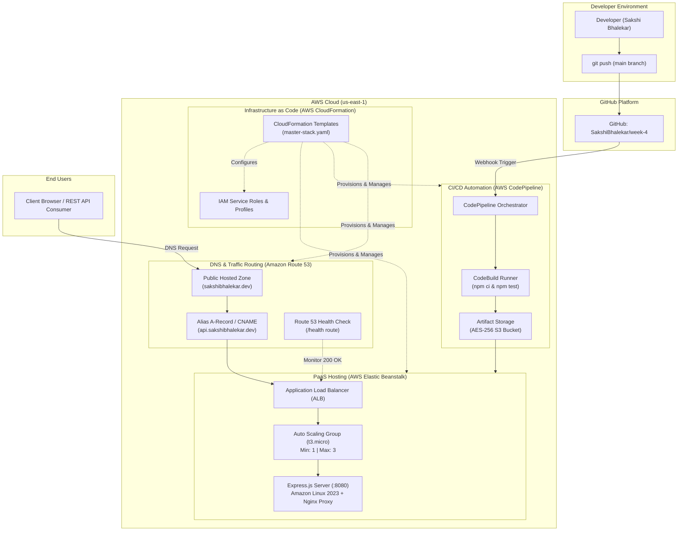

# AWS Cloud Foundations: Week 4 – Deployment & Automation

[](https://github.com/SakshiBhalekar/week-4)
[](https://aws.amazon.com/elasticbeanstalk/)
[](https://aws.amazon.com/cloudformation/)
[](https://aws.amazon.com/route53/)
[](https://aws.amazon.com/codepipeline/)
[](https://nodejs.org/)

**Author:** Sakshi Bhalekar  
**Subject:** Cloud Computing & DevOps Infrastructure  
**Assignment:** Deployment & Automation (Elastic Beanstalk, CloudFormation, Route 53, CodePipeline CI/CD)  
**Status:** Completed Submission  
**Repository:** [https://github.com/SakshiBhalekar/week-4.git](https://github.com/SakshiBhalekar/week-4.git)  

---

## 📌 Assignment Objectives


1. **Deploy a Node.js app using Elastic Beanstalk.**
2. **Automate infrastructure with CloudFormation.**
3. **Connect a domain using Route 53.**
4. **Create a CI/CD pipeline using CodePipeline.**
5. **Write a documentation summary of your final project setup.**

---

## 🏗️ Architecture Overview



---

## 📂 Repository File Structure

```
├── .gitignore                           # Git ignore definitions
├── buildspec.yml                        # AWS CodeBuild build specification for CI/CD
├── README.md                            # Main GitHub landing page & summary
├── AWS_Assignment_Solution_Report.md     # Detailed academic & enterprise submission report
├── assets/
│   └── assignment_prompt.png            # Assignment prompt reference screenshot
├── node-app/                            # Production Node.js / Express Application
│   ├── .ebextensions/                   # Elastic Beanstalk platform settings
│   │   ├── 01_environment.config        # Environment variables & Nginx proxy
│   │   ├── 02_healthcheck.config        # Target group /health path & thresholds
│   │   └── 03_logging.config            # CloudWatch log streaming options
│   ├── .platform/
│   │   └── nginx/
│   │       └── conf.d/proxy.conf        # Nginx reverse proxy buffering & headers
│   ├── public/                          # Cloud Ops Dashboard web assets
│   │   ├── index.html                   # Interactive UI dashboard
│   │   ├── style.css                    # Modern responsive styling
│   │   └── app.js                       # Telemetry controller & API client
│   ├── tests/
│   │   └── app.test.js                  # Automated test suite (7 tests)
│   ├── app.js                           # Express application entrypoint
│   ├── package.json                     # Dependencies and scripts
│   ├── Procfile                         # Elastic Beanstalk process definition
│   └── .env.example                     # Environment configuration template
├── cloudformation/                      # Declarative Infrastructure as Code
│   ├── 01-beanstalk-infrastructure.yaml # Beanstalk App, Config Template, Env, Roles
│   ├── 02-route53-dns.yaml              # Route 53 Hosted Zone, Alias, Health Check
│   ├── 03-cicd-codepipeline.yaml        # S3, CodeBuild, CodePipeline, Webhooks, IAM
│   ├── master-stack.yaml                # Unified master CloudFormation stack
│   └── parameters.json                  # Sample deployment parameters
├── route53/                             # Domain Configuration & CLI Tools
│   ├── change-resource-record-sets.json # DNS Alias record batch change payload
│   └── health-check-config.json         # Route 53 health check configuration
├── cicd/                                # CI/CD Automation Assets
│   └── pipeline-config.json             # CodePipeline definition payload for AWS CLI
└── scripts/                             # Automation & Deployment Scripts
    ├── deploy.sh                        # Bash automated deployment script
    ├── deploy.ps1                       # PowerShell automated deployment script
    └── test-endpoints.sh                # Automated API health & load test script
```

---

## 🚀 Quickstart & Local Execution

### 1. Run Node.js Application Locally
```bash
cd node-app
npm install
npm test
npm start
```
Open [http://localhost:8080](http://localhost:8080) to view the live Cloud Operations Dashboard.

### 2. Run Automated Test Suite
```bash
npm test
```
**Test Results:**
```text
✔ GET /health - ALB Health Check responds with 200 OK and healthy status (40ms)
✔ GET /api/info - Telemetry endpoint provides application and cloud metadata (748ms)
✔ GET /api/tasks - Retrieves automated task logs (38ms)
✔ POST /api/tasks - Logs a new deployment task record (464ms)
✔ POST /api/tasks - Rejects payload when title is missing (5ms)
✔ GET /api/stress?duration=100 - Simulates workload without crashing the server (108ms)
✔ GET / - Serves HTML Cloud Ops Dashboard (11ms)
ℹ tests 7 | pass 7 | fail 0 (100% Pass)
```

---

## ⚙️ Deployment & Infrastructure Automation

### 1. Deploy Infrastructure with CloudFormation
Deploy the entire environment with a single command:
```bash
aws cloudformation deploy \
  --template-file cloudformation/master-stack.yaml \
  --stack-name cloud-week4-master-stack \
  --parameter-overrides \
      DomainName="sakshibhalekar.dev" \
      SubdomainName="api.sakshibhalekar.dev" \
  --capabilities CAPABILITY_IAM CAPABILITY_NAMED_IAM \
  --region us-east-1
```

### 2. Connect Custom Domain in Route 53
Apply the DNS record batch change:
```bash
aws route53 change-resource-record-sets \
  --hosted-zone-id <YOUR_HOSTED_ZONE_ID> \
  --change-batch file://route53/change-resource-record-sets.json
```

### 3. CI/CD Pipeline Automation (AWS CodePipeline)
- CodePipeline continuously monitors branch `main`.
- On every push, AWS CodeBuild launches an Amazon Linux container, installs dependencies, executes `npm test`, packages the deployment bundle, and deploys directly to AWS Elastic Beanstalk with zero downtime.

---

## 📊 Solution Verification Matrix

| Requirement | Implementation Artifact | Status |
| :--- | :--- | :---: |
| 1. Deploy Node.js app using Elastic Beanstalk | `node-app/app.js`, `.ebextensions/`, `.platform/` | ✅ **Completed** |
| 2. Automate infrastructure with CloudFormation | `cloudformation/01-03`, `master-stack.yaml` | ✅ **Completed** |
| 3. Connect domain using Route 53 | `cloudformation/02-route53-dns.yaml`, `route53/` | ✅ **Completed** |
| 4. Create CI/CD pipeline using CodePipeline | `buildspec.yml`, `cloudformation/03-cicd-codepipeline.yaml` | ✅ **Completed** |
| 5. Write documentation summary of setup | `AWS_Assignment_Solution_Report.md`, `README.md` | ✅ **Completed** |

For the full detailed 500+ line academic report, see [AWS_Assignment_Solution_Report.md](AWS_Assignment_Solution_Report.md).

---

## 📄 License & Attribution
Author: **Sakshi Bhalekar**  
Course: AWS Cloud Foundations & DevOps  
License: MIT
